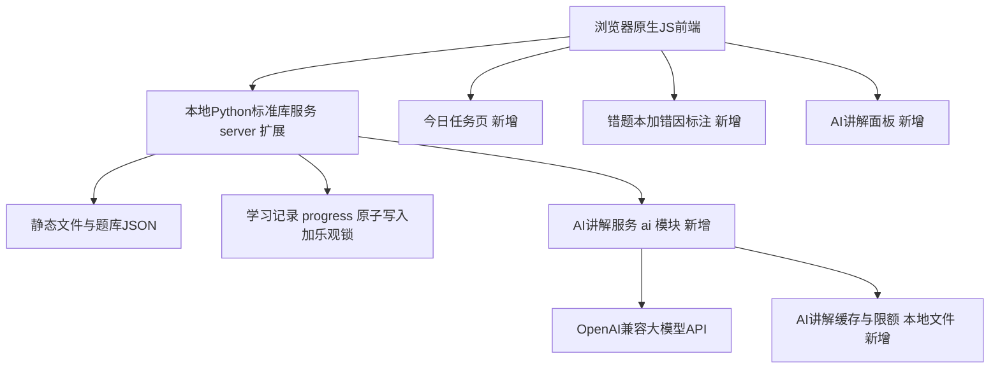

# 复用分析与技术选型报告

**日期：** 2026-10-30
**依据：** 《FDE Exam Coach 产品需求文档（PRD V1.0）》 Milestone 0
**结论先行：采用方案 A —— 以 FDE_Learning 为基座扩展，不重写。**

---

## 1. 参考项目概览

### 1.1 FDE_Learning（复用基座）

| 项目 | 信息 |
|---|---|
| 地址 | https://github.com/mickorz/FDE_Learning |
| 参考 commit SHA | `abd668708cf9c876069908b1d30b8fa3010cd6c5` |
| 技术栈 | Python 3.9+ 标准库 HTTP 服务 + 原生 JavaScript/CSS 前端，零第三方运行时依赖 |
| 代码规模 | server.py 101 行；src/ 共 4 个 JS 模块约 40KB；测试覆盖 core/store/server/浏览器回归 |
| 许可状态 | LICENSING.md 声明"许可待权利人确认"；本项目为同一作者的个人备考衍生使用，公开发布（Phase 2）前需完成授权确认 |

### 1.2 wrong-notebook（AI 能力参考）

| 项目 | 信息 |
|---|---|
| 地址 | https://github.com/margrop/wrong-notebook |
| 参考 commit SHA | `8329c20266183156b548ca05574f026df3823ada` |
| 技术栈 | Next.js 16 + React 19 + TypeScript + Prisma 5 + SQLite，多用户 AI 错题本 |
| 定位 | 只借鉴 AI 工程化设计（prompt、容错、字段），不迁移框架代码 |

---

## 2. FDE_Learning 能力盘点 vs P0 清单

### 2.1 逐项映射

| P0 需求 | FDE_Learning 现状 | 结论 |
|---|---|---|
| FR-001 题库管理 | `data/questions.json` 1000 题全量（500 eligible / 458 learning_only / 42 hold）；稳定 ID + contentHash 题目版本；质量分级 `data/quality.json`；章节筛选、关键词搜索（题干/考点/ID/选项）；待修订题经 `examUse==='hold'` 隔离，不进练习与组卷 | **已实现，直接复用** |
| FR-002 基础刷题 | 章节练习、错题重做、收藏练习、解析与干扰项解释、官方来源链接、键盘操作；attempt 记录 `{at, answers, correct, questionVersion}`；localStorage 应急副本 + 服务端 revision 乐观锁 | **缺两项**：无"未做题"筛选；attempt 未记录练习模式 |
| FR-003 模拟考试 | 25min/15 题短练 + 90min/60 题完整练习；`makeExam` 按官方模块占比（最大余数法）组卷并**冻结题目快照**；`gradeExam` 按快照计分（题库修改不影响历史成绩）；计时、暂存（activeExam 持久化）、超时自动交卷、历史成绩 | **已实现，直接复用**；补考试报告的模块维度统计 |
| FR-004 智能错题本 | 答错自动入错题本（`lastCorrect===false`）；查看原题/解析/来源；历史作答次数完整保留；答对退出待纠正列表但不删历史；按模块筛选 | **缺两项**：错因标注；错题状态机（待复习/复习中/暂时掌握/已掌握） |
| FR-005 AI 错题讲解 | 无 | **全新开发**（本次工作量主体） |
| FR-006 今日学习任务 | 有"学习进度"页（覆盖率、正确率、章节进度）和考试目标日期设置，但无首页任务聚合 | **全新开发**（推荐逻辑 + 首页） |

### 2.2 工程质量亮点（复用价值评估）

这些是重写最容易丢的隐性资产，全部有测试背书：

1. **考试快照计分**：`gradeExam` 优先从 `exam.snapshot` 取题，历史成绩与题库演进完全解耦（PRD FR-003 验收第 5 条直接满足）。
2. **contentHash 题目版本**：修订题沿用 ID 但换哈希，旧作答不计入新版掌握统计（`currentRecord` 按 version 过滤 attempts）。
3. **可靠写入**：`server.py` 临时文件 + fsync + `os.replace` 原子替换；revision 乐观锁防多窗口覆盖（返回 409 而不是静默合并）。
4. **备份验证与合并**：`validateBackup` 全字段校验（含原型污染防护）+ `mergeBackup` 去重合并，导出/导入/应急恢复三通道。
5. **失败可见**：保存失败在 UI 显著提示并阻止离开页面，符合"不吞错误"原则。

### 2.3 已确认的缺口清单（即 P0 开发范围）

- G1（FR-002）：未做题练习入口；attempt 记录练习模式。
- G2（FR-003）：考试结果页按模块（知识点）统计错题。
- G3（FR-004）：错因五分类标注（PRD 场景 B 定义：知识点不理解 / 相似概念混淆 / 记忆不牢固 / 审题失误 / 题目或答案争议）；错题四态由作答历史推导，不单独落库。
- G4（FR-005）：AI 讲解服务端 + 前端面板（详见第 4 节）。
- G5（FR-006）：今日任务首页与推荐逻辑。

---

## 3. wrong-notebook 借鉴清单

只搬"设计"，不搬"代码"。

### 3.1 值得借鉴（按优先级）

| 要素 | 来源 | 迁移方式 |
|---|---|---|
| 复习调度纯函数化 | `src/lib/review-schedule.ts`：固定间隔 `[1,2,4,7,15,30]` 天 + 末尾连续做对数定档 + 做错归零 + **调度状态不落库、从作答记录实时推导** | P0 直接沿用 FDE_Learning 等价机制（`[1,3,7,14,30]` 天 + 答错 10 分钟），P1 对齐参数并加考试临近封顶 |
| 规则掌握度公式 | `src/lib/mastery.ts`：时间衰减 0.7 + 难度加权 + 先验收缩（PRIOR=0.3），输出 0~1 概率 | P1 知识点掌握评估（FR-007）的算法蓝本，可解释、零依赖 |
| AI 输出容错解析 | `ai/schema.ts` `extractJsonObject`：剥代码块围栏 → 截取首尾大括号 → 类型强转校验；校验失败降级手工解析 | Python 侧十几行复刻，AI 讲解 JSON 解析采用 |
| 讲解类 prompt 结构 | `prompts.ts`：明确输入字段清单、输出结构约束、防注入条款、争议点强制上报 | 撰写 `prompts.py` 讲解模板 v1 的参考 |
| 可追溯 AI 结论四元组 | `masteryProbability/Reason/Source/EvaluatedAt`（来源 ai 或 rule，可回滚） | AIExplanation 记录字段设计：`model`、`promptVersion`、`createdAt`、`rawRef` |
| AI 结果缓存与限额 | `ErrorItem.lastPractice` 缓存最近一次生成；`AiUsage` 表支撑每日额度 | 简化为：讲解缓存键 = 题目 contentHash + 用户答案 + 模型 + prompt 版本；每日限额本地计数 |

### 3.2 不迁移（明确排除）

- Prisma / NextAuth / 多用户体系（单用户用不上，Phase 2 再按需设计云端 schema）。
- 10 家供应商预设、Azure、MiniMax OAuth 签到模块（保留 1 个 OpenAI 兼容渠道即可）。
- SVG 配图生成、TTS 语音、LaTeX 修复、GeoGebra（与 FDE 备考无关）。
- Docker / HTTPS 反代 / e2e 矩阵（本地单机运行）。
- 枚举式错因分类：该项目实际只有三态 `mistakeStatus` + 自由文本，**错因五分类以 PRD 定义为准**。

---

## 4. 技术选型决策

### 4.1 方案对照（按 PRD 6.1 评估维度）

| 维度 | 方案 A：FDE_Learning 扩展 | 方案 B：Next.js + React + SQLite 重写 |
|---|---|---|
| 首次可用时间 | 拷贝即用，扩展约 2~3 天，**11-01 前可交付** | 重写题库/刷题/模考/备份，预估 5~8 天，**无法按时稳定交付** |
| 题库兼容性 | 零迁移（同一套 JSON） | 需要迁移加载与校验逻辑 |
| 测试工作量 | 沿用现有 node --test + unittest，只测增量 | 全部重写 |
| 数据迁移风险 | 无（progress.json 格式不变，向后兼容字段追加） | 新格式，需双向迁移工具 |
| 开发复杂度 | 低（标准库 + 原生 JS，无构建链） | 高（框架 + ORM + 构建） |
| 小程序可复用程度 | 业务规则集中在 core.js（纯函数）与 server.py（HTTP），Phase 2 可移植到服务端语言重写 API；数据模型可直接映射 SQLite | 天然 API 化 |

**决策：方案 A。** 触发条件即 PRD 决策原则本身——方案 B 无法在 11 月 1 日前交付稳定刷题版本，且方案 A 并不牺牲第二阶段：评分、复习调度、组卷规则全部是纯函数，数据实体（Question/ExamSession/AnswerAttempt/AIExplanation）与 PRD 6.3 建议一一对应，届时迁移的是"规则与数据"，不是界面。

### 4.2 目标架构（Phase 1）



### 4.3 主工程结构（`app/` 目录，`thirdparties/` 保持只读）

```
app/
├── server.py              # 基于 FDE_Learning server.py 扩展：+ /api/ai/* 端点
├── ai/
│   ├── __init__.py
│   ├── client.py          # 标准库 urllib 调 OpenAI 兼容 /chat/completions
│   ├── prompts.py         # 讲解提示词模板（版本号管理）
│   ├── store.py           # ai-explanations.json 缓存 + 每日限额
│   └── example_test 相关
├── src/
│   ├── core.js            # 复用 + attempt.mode 字段、错题状态推导、今日推荐纯函数
│   ├── store.js           # 复用
│   ├── app.js             # 复用 + 未做题筛选 + 错因标注 + AI 面板
│   ├── today.js           # 新增：今日任务页
│   └── rounds.js          # 复用
├── data/                  # 拷贝自 FDE_Learning @abd6687，记录来源 SHA，不做任何修改
├── tests/                 # 沿用 + 新增 test_ai_*.py 与 core 增量测试
└── index.html
```

数据文件保持两库分离：`local-data/progress.json`（学习记录，沿用现有备份体系）与 `local-data/ai-explanations.json`（AI 生成内容，独立 schema，不混入原始题库——满足 PRD"AI 内容与原始题库分离"）。

### 4.4 AI 服务设计要点（FR-005）

1. **调用链路**：浏览器 → 本地 server `/api/ai/explain` → 上游模型 API。API Key 只存 `local-data/config.json`（gitignore）或环境变量，永不下发浏览器。
2. **输入**：题干、选项、原始答案、原始解析、考点、模块、用户答案、官方来源（url+fact）。
3. **输出 JSON**：正确答案解释 / 用户答案为何不符合 / 核心知识点 / 易混淆概念 / 建议复习内容 / 争议或不确定点；外加 `agreesWithOfficial` 布尔字段用于冲突检测——为 false 时前端显示"待复核"横幅，AI 不静默改答案。
4. **可靠性**：标准库 urllib、超时与重试各一次；解析失败返回结构化错误；**AI 任何失败都不阻塞刷题主流程**（按钮态恢复 + 提示保留原始解析可用）。
5. **缓存与限额**：同题同答案同模型同 prompt 版本命中缓存直接返回；每日调用上限默认 50 次，超限明确报错；每次调用记录模型名、prompt 版本、耗时、时间戳。

---

## 5. P0 开发计划与验收标准

> 交付原则：先让 11-01 能用上稳定刷题 + AI 讲解，P0 完成后立即投入真实刷题验证，不提前开发 P1（PRD 执行要求第 10 条）。

| # | 任务 | 内容 | 验收标准 |
|---|---|---|---|
| T1 | 主工程搭建 | 拷贝 FDE_Learning@abd6687 至 `app/`，标注来源 SHA 与许可状态；现有测试全绿 | `node --test` 与 `python -m unittest` 通过；README 记录来源 |
| T2 | FR-001 题库接入验证 | 题库完整性测试：题量 1000、质量分级计数（500/458/42）、hold 不入组卷、答案字段抽样比对 | 自动化断言通过；重复导入幂等（静态文件天然满足，测试覆盖） |
| T3 | FR-002 刷题补全 | "未做题"筛选池；attempt 增加 mode 字段（chapter/random/wrong/favorite/unseen/review/exam） | 作答记录含模式；刷新不丢记录（现有持久化）；旧备份兼容（缺 mode 不报错） |
| T4 | FR-003 模考补全 | 结果页按模块统计对错；快照计分回归测试（改题库后旧成绩分数不变） | 模块统计展示正确；快照不变性测试通过 |
| T5 | FR-004 错题本补全 | 错因五分类标注（答错后提示选择，可跳过，可改选）；错题四态推导：待复习（最近错）/复习中（due 未到）/暂时掌握（连续对 1~2 次）/已掌握（连续对 ≥3 次），全部由 attempts 实时推导 | 错因持久化且可修改；四态展示与推导规则一致；答对不删历史 |
| T6 | FR-005 AI 讲解 | 第 4.4 节全部内容 + 前端讲解面板 | 未配置 Key 时功能优雅降级；断网/AI 报错不影响答题；同题二次点击命中缓存；冲突触发待复核；讲解记录含模型与 prompt 版本 |
| T7 | FR-006 今日任务 | 新增"今日"首页：考试倒计时、今日新题目标（默认 30，可调）、到期复习数、核心完成率、最近成绩、薄弱模块、一键进入对应练习 | 推荐数据全部来自真实作答记录；未完成任务不自动标记完成 |
| T8 | 自动化测试与 E2E | Python：AI 端点（prompt 组装/缓存/限额/配置读取，mock 上游）；Node：T3~T7 增量纯函数；端到端流程脚本：导入题库→章节练习→答错→错题记录→AI 讲解→安排复习→再作答（测试用独立 data 目录） | 全部测试通过；E2E 跑在临时目录不污染真实记录 |
| T9 | 启动与文档 | Windows 启动脚本；主工程 README；更新进度文档 | 双击即可启动；文档与仓库状态一致 |

**P0 验收口径（对应 PRD Milestone 1）：** 能用真实 1000 题题库完整刷题与模考；学习记录不丢失（含备份导出导入回归）；AI 讲解失败不影响普通答题；以上全部有自动化测试背书。

---

## 6. 风险与对策

| 风险 | 对策 |
|---|---|
| FDE_Learning 许可未定 | 第一阶段个人使用无碍；Phase 2 公开发布前完成授权确认（PRD 5.5 已列前置条件），本报告与 README 均记录来源 SHA 备查 |
| 原生 JS 单文件 UI 越改越难维护 | P0 只做增量插入（today.js 独立文件、AI 面板独立渲染函数），不重构 app.js；若 Phase 2 需要组件化，届时按方案 B 重写 UI 而保留 core 规则 |
| AI 模型输出不稳定 | 容错 JSON 提取 + 结构化错误 + 原始解析兜底展示；讲解永远可跳过 |
| 扩展破坏现有备份兼容 | 新字段全部可选、旧备份经 `validateBackup`/`mergeBackup` 必须仍可用（纳入测试） |

---

## 引用说明

- PRD：本仓库 `dev-docs/design/FDE Exam Coach 产品需求文档（PRD V1.0）.md`
- FDE_Learning @ `abd6687`：`thirdparties/FDE_Learning/`（server.py、src/core.js、src/app.js、src/store.js、data/manifest.json、LICENSING.md、README.md）
- wrong-notebook @ `8329c20`：`thirdparties/wrong-notebook/`（src/lib/review-schedule.ts、src/lib/mastery.ts、src/lib/ai/prompts.ts、src/lib/ai/schema.ts、prisma/schema.prisma）
- 腾讯云官方考试指南（FDE_Learning 题库来源依据）：https://cloud.tencent.com/document/product/658/137832
